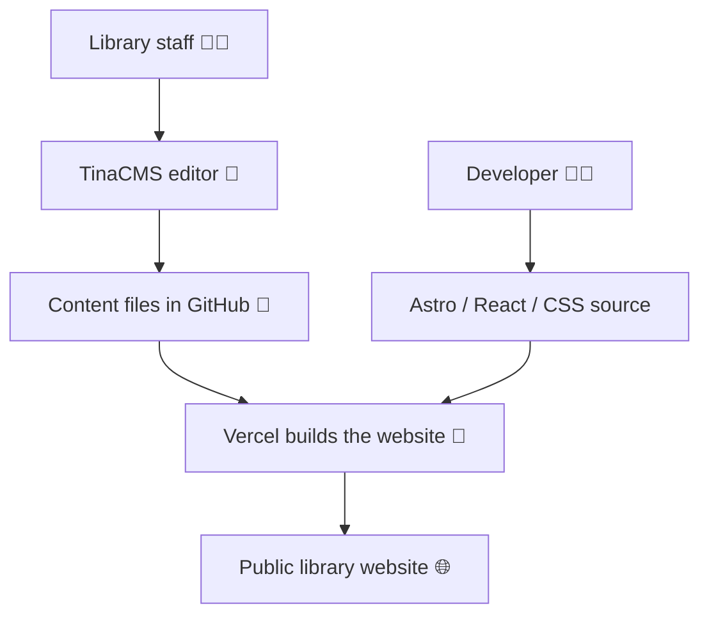

# 🌲 Goff-Nelson Memorial Library
### A beginner-friendly guide to the website and TinaCMS

This is the **new library website**, built with **Astro + React** and hosted by **Vercel**. **TinaCMS** gives library staff a simple, private editor for updating events, books, photos and hours. You, as the developer, **keep full access to every line of code** in GitHub and VS Code.

> **Current status (November 20, 2026):** The TinaCMS integration has been **merged into the main branch**, and automated content, TypeScript/Astro, and build checks passed. **TinaCloud credentials and a real staff login/editing test are still required** before calling the editor operational. WCAG 2.2 AAA is an accessibility **goal**, not an achieved certification.

## 🔧 TinaCloud says “Invalid Client ID”?

Go straight to **[Fix “Invalid Client ID” — step-by-step for TinaCloud + Vercel](docs/TINACMS_CONNECTION_FIX.md)**.

The short version: copy the **Client ID** from your **TinaCloud Overview**, add it in **Vercel → Project → Settings → Environment Variables** under **`PUBLIC_TINA_CLIENT_ID`**, add your **private `TINA_TOKEN`** separately, select **Production**, and **redeploy**. The editor embeds the settings at build time. The required `tina/tina-lock.json` schema is now tracked in GitHub. Never paste the token into your repository.

## 🌼 First, choose what you want to do

| I want to… | Read this section |
| --- | --- |
| Set up TinaCMS for the first time | [Part 1: Connect GitHub to Tina](#part-1--connect-github-to-tina) |
| Make Tina work on my hosted site | [Part 2: Connect Vercel](#part-2--connect-vercel) |
| Teach a staff member to edit content | [Part 3: Staff editing walkthrough](#part-3--staff-editing-walkthrough) |
| Continue changing the site myself | [Part 4: Developer instructions](#part-4--developer-instructions) |
| Fix a confusing problem | [Troubleshooting](#-troubleshooting) |

### How everything works



**Good to know:** TinaCMS changes **content**. It does not prevent you from editing the design, navigation, React components, CSS, or other source code. The public can use the website without logging in.

---

## Part 1 — Connect GitHub to Tina

Do this once as the developer or website administrator.

### Step 1 — Sign into TinaCloud
1. Open **[app.tina.io](https://app.tina.io)** in a browser.
2. Choose **Sign in** or **Get started**.
3. Sign in with **GitHub** when offered.
4. GitHub might display a permission screen. Approve Tina for **OofMacie/goffnelson**.
5. If Tina asks you to create a new project, choose an appropriate name such as **Goff-Nelson Memorial Library**.

**Important:** You already have a website! Don't select a brand-new sample website or replace the existing GitHub repository.

### Step 2 — Select your project

| Tina field | Choose this |
| --- | --- |
| GitHub owner | **OofMacie** |
| Repository | **goffnelson** |
| Production branch (already merged) | **main** |
| Optional separate testing branch | **feat/tinacms-library-editor** |

**What is a branch?** Think of it as a separate working copy of the website. The *test branch* allows safe previews without putting edits directly on the public website. The TinaCMS code is **already in main**, which is the branch normally used for production.

### Step 3 — Locate your TinaCloud credentials

In your TinaCloud project's settings/configuration, find:

- **Client ID** — this connects the website to the correct TinaCloud project.
- **Read-only token** — this lets the website build process read the content.

The exact TinaCloud menu labels may change over time. Keep these values handy for Part 2, but **do not post the token into GitHub, a screenshot, or a message**.

✅ **You're done with Part 1 when:** TinaCloud shows the correct repository and you can locate the Client ID and token.

---

## Part 2 — Connect Vercel

Vercel is the service that publishes the site. We'll tell Vercel how to connect to TinaCloud **without putting secrets in source code**.

### Step 1 — Open your Vercel project
1. Visit **[vercel.com/dashboard](https://vercel.com/dashboard)** and sign in.
2. Choose the project that publishes **goffnelson.vercel.app**.
3. Click **Settings → Environment Variables**.
4. Choose **Add Environment Variable**.

An *environment variable* is a named setting that Vercel provides to your website at build time.

### Step 2 — Add these two settings

| Key (type it exactly) | Value |
| --- | --- |
| **PUBLIC_TINA_CLIENT_ID** | Your TinaCloud **Client ID** |
| **TINA_TOKEN** | Your TinaCloud **read-only token** |

The public site can build without these settings, but staff cannot use the connected TinaCloud editor until they are configured. For safe initial testing, select **Preview** for the **feat/tinacms-library-editor** branch. For the public editor, you must **also add the two variables to Production** and make sure TinaCloud is connected to **main**. Never put the token in a public file. The Client ID is meant to be public; the token is not. <strong>Save</strong> each variable.

### Step 3 — Open the testing deployment
1. Click **Deployments** in the Vercel project.
2. For an isolated test, select the deployment for **feat/tinacms-library-editor**. For the live site, select the deployment for **main**.
3. If you added variables after deployment, click **Redeploy**.
4. Open the deployment URL Vercel gives you.
5. Add **/admin/index.html** to the end of its address.

For example: `https://YOUR-PREVIEW-URL/admin/index.html` (replace this example with the real address Vercel shows).

### Step 4 — Test that it truly works
1. Sign in to TinaCMS.
2. Choose **Home page**.
3. Temporarily change one word in the welcome heading.
4. Press **Save**.
5. Check for a new content commit in the **testing branch** on GitHub.
6. Check Vercel **Deployments** and reload the **preview website** when deployment succeeds.
7. Confirm the new word appears. Then change it back and save again.

✅ **You're done with Part 2 when:** a Tina edit becomes a GitHub commit and appears on the preview website.

### Finish the production connection

The TinaCMS code is **already merged into main**. Once the preview workflow has been verified:
1. Set the TinaCloud project's live branch to **main**, as appropriate for your project.
2. Add the same two Vercel variables to **Production** (keep the token private).
3. Redeploy the production site.
4. Test signing in and making a content edit once more.
5. Invite library employees using their own Tina accounts and your plan's permissions.

**Do not give staff the production login until the complete workflow is verified.**

---

## Part 3 — Staff editing walkthrough

Staff **do not need GitHub or coding knowledge** to do their normal content editing.

### Open the editor
1. Open the library's Tina admin link: **YOUR-LIBRARY-SITE/admin/index.html**.
2. Sign in with your authorized Tina account.
3. Choose what you want to edit.
4. Fill in the fields, click **Save**, and check the updated website after Vercel finishes deploying.

| Choose this in Tina | What staff can edit |
| --- | --- |
| **Home page** | Welcome heading, intro text, main picture, picture description |
| **Events and programs** | Titles, dates, times, descriptions, categories, photos, links |
| **Staff book picks** | Book names, authors, ISBNs, covers and display order |
| **Library information** | About text, address, telephone number, hours, Facebook URL |

**Visual editing:** The **Home page** is set up for contextual click-to-edit preview. Other sections use clear, structured forms instead of a drag-and-drop page designer.

### Example A — Add a library event
1. Click **Events and programs**.
2. Open **Upcoming Events**.
3. Find the **Programs** list and choose **Add item (+)**.
4. Enter the **event name**, **date or repeating schedule**, **time**, **description**, and **category**.
5. Choose a picture, if desired, and write a useful description of what it shows.
6. Add a real event webpage link if one exists. Otherwise leave that optional field blank.
7. **Save**, then visit the Events page to double-check.

Example: **Story Time for Tots** · **Every Tuesday** · **10:30 AM**. Always verify details against the library's current schedule.

### Example B — Change library hours
1. Click **Library information**.
2. Open the settings document and find **Opening hours**.
3. Select the day group to change.
4. Enter times in 24-hour format: **09:00 = 9 AM**, **17:00 = 5 PM**.
5. If closed that day, enable **Closed all day**.
6. **Save** and check the footer of the published website.

**Why this is helpful:** Opening hours are stored in one place, so the footer and search-engine metadata use the same information.

### Example C — Change book recommendations
1. Click **Staff book picks** and open the book-list document.
2. Add a book or choose an existing book to edit.
3. Fill in **title**, **author**, **ISBN** and **cover image**.
4. Reorder the list if needed and **Save**.
5. Check the book carousel on the public website.

### Before pressing Save
- [ ] Are names, dates, and phone numbers correct?
- [ ] Does each informative photo have a meaningful description (alt text)?
- [ ] Are event links real rather than placeholders?
- [ ] Is the information easy to read and understand?
- [ ] Does it still make sense on a phone?

**Made a mistake?** Edit and save again. A developer can also restore an earlier version of the content using GitHub history.

---

## Part 4 — Developer instructions

You can keep coding **directly in GitHub or VS Code**, just as before! You do not have to open TinaCMS to update your own components, animations, styles or layout.

### Open the project locally
1. Install **[Node.js](https://nodejs.org/)** version **22.22 or newer**, Git and VS Code.
2. Open your local **goffnelson** project in VS Code.
3. Open **Terminal → New Terminal**.
4. Run these commands **one line at a time**:

```bash
git switch main
git pull origin main
npm ci
npm run dev
```

5. Open **http://localhost:4321** to view your site.
6. Open **http://localhost:4321/admin/index.html** for the local Tina editor.

If you need cloud credentials locally, make an **.env** file by copying **.env.example**, fill in your own values, and **never commit .env**.

### Project map

```text
goffnelson/
├── README.md                    ← You are here
├── content/                     ← Content that staff edit in Tina
│   ├── home/home.json
│   ├── events/events.json
│   ├── books/books.json
│   └── settings/settings.json
├── tina/config.ts               ← Fields and editing forms in Tina
├── src/
│   ├── components/              ← React and Astro display components
│   ├── pages/                   ← Website routes
│   ├── layouts/                 ← Shared page HTML
│   ├── lib/library-content.ts   ← Shared content loader
│   └── styles/                  ← Developer styles
├── public/css/                  ← Main design system and stylesheet
└── docs/                        ← Further setup and accessibility notes
```

### Helpful terminal commands

| Command | Meaning |
| --- | --- |
| `npm ci` | Install the exact versions in the lockfile |
| `npm run dev` | Start the local website and editor |
| `npm run content:check` | Check content for missing or invalid values |
| `npm run check` | Generate Tina types and check Astro/TypeScript |
| `npm run build:local` | Build without connecting to TinaCloud |
| `npm run build` | Automatically uses TinaCloud when credentials exist, otherwise builds from local content |
| `npm run build:cloud` | Connected TinaCloud build (requires credentials) |
| `npm run format:check` | Check formatting |

**Keep code clean and DRY:** One piece of information lives in one place. Content stays in **content/**, reusable display components stay in **src/components/**, and Tina's form definitions stay in **tina/config.ts**. You should not have to duplicate opening hours in multiple files.

---

## 🧰 Troubleshooting

**Tina says it cannot find the repository.** Check that the GitHub owner is **OofMacie**, the repo is **goffnelson**, and Tina is authorized to access it.

**The admin link shows a 404 or blank screen.** Check that you opened the correct *branch preview* on Vercel, both environment variables exist, and you redeployed after adding them. Look at **Vercel → Deployments → Build Logs** for errors.

**I saved something but the website looks unchanged.** Check the **branch** Tina saved to. A preview-branch change will not appear on the production main branch. Check that the latest Vercel deployment succeeded.

**What do these words mean?** **GitHub** stores code and versions. **Repository** is the project folder. **Branch** is a safe parallel version. **Astro/React** build the site. **TinaCMS** edits content. **Vercel** publishes the site. **Deploy** means build/publish the latest version. **Environment variable** is a configuration value supplied by the hosting platform.

---

## Before publishing

- [x] Feature-branch GitHub Actions passed: npm ci, content check, Astro/TypeScript check, and local build.
- [ ] Confirm Vercel's production deployment succeeds after the merge.
- [ ] You have personally tested a TinaCloud login and a real edit through Vercel.
- [ ] Navigation has no dummy links or unimplemented buttons.
- [ ] Library staff confirm opening hours and programs.
- [ ] Keyboard, screen reader, zoom, contrast, mobile layout, focus and editorial content undergo a **manual WCAG 2.2 AAA audit**. Automated checks alone are insufficient, and the site is **not presently certified AAA**.

Read the more technical **[Tina setup guide](docs/TINACMS_SETUP.md)** and **[accessibility audit](docs/ACCESSIBILITY_AAA_AUDIT.md)**.

### Helpful official websites

[TinaCMS Astro integration](https://tina.io/docs/frameworks/astro) · [Tina visual editing](https://tina.io/docs/contextual-editing/astro) · [Vercel environment variables](https://vercel.com/docs/environment-variables) · [WCAG 2.2 specification](https://www.w3.org/TR/WCAG22/)

**Current site:** https://goffnelson.vercel.app · **GitHub:** https://github.com/OofMacie/goffnelson
